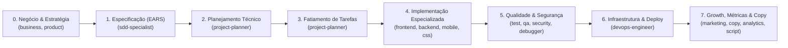

# Arquitetura da Informação: Categorização de Agentes e Skills

> Guia oficial de taxonomia e organização funcional do **Ananke OS**.
> Estruturado para apoiar o fluxo de trabalho definido em [../ARCHITECTURE.md](../ARCHITECTURE.md) e a metodologia Spec-Driven Development descrita em [../how_to.md](../how_to.md).

---

## 🧭 Visão Geral e Princípios de Organização

O **Ananke OS** opera como um ecossistema modular composto por **35 Agentes Especialistas**, **54 Skills de Domínio**, **21 Workflows de Comando** e **Scripts de Validação Automatizada**.

Para eliminar suposições (*"vibe coding"*) e garantir precisão cirúrgica no direcionamento de cada demanda profissional, os recursos estão organizados em **Macro-Categorias por Tipo de Serviço e Escopo de Trabalho**.

### Integração com o Fluxo SDD (Spec-Driven Development)

Conforme instruído no [../how_to.md](../how_to.md), as demandas técnicas seguem o ciclo de vida abaixo, onde cada categoria de agente entra em ação no momento exato:

---

## 🗂️ Macro-Categorias de Serviços e Tarefas

Abaixo está o mapeamento detalhado das 21 categorias funcionais do sistema:

---

### 1. Estratégia de Negócios, Precificação e Gestão de Produto
*Foco: Viabilidade econômica, definição de modelo de receita, gestão de escopo e visão estratégica do produto.*

* **Quando utilizar:** Definição de preços de produtos/serviços, estruturação de pacotes e bundles comerciais, elaboração de roadmaps, levantamento de requisitos com stakeholders e definição de MVPs.
* **Agentes Especialistas:**
  * [`business-strategist.md`](../agents/business-strategist.md) - Estratégia de monetização, modelos de negócio, precificação e análise de sensibilidade.
  * [`product-manager.md`](../agents/product-manager.md) - Requisitos de negócio, visão de longo prazo, PRDs e métricas de sucesso (KPIs).
  * [`product-owner.md`](../agents/product-owner.md) - Refinamento de backlog, redação de User Stories, critérios de aceite e priorização de sprints.
  * [`project-planner.md`](../agents/project-planner.md) - Planejamento executivo de projetos, levantamento técnico de escopo e arquitetura de entrega.
* **Skills Associadas:**
  * [`pricing-strategy`](../skills/pricing-strategy/SKILL.md) - Modelagem de precificação, ancoragem de preço e pacotes.
  * [`brainstorming`](../skills/brainstorming/SKILL.md) - Maiêutica socrática para exploração de premissas e descoberta de requisitos.
  * [`plan-writing`](../skills/plan-writing/SKILL.md) - Decomposição estruturada de metas, marcos e dependências.
* **Workflows Relacionados:** `/strategy`, `/plan`, `/brainstorm`
* **Etapa no SDD:** Pré-Fase & Fase 2 (Plan).

---

### 2. Especificação Formal e Requisitos de Software (SDD)
*Foco: Derivação de regras de negócio estritas e contratos funcionais sem ambiguidade.*

* **Quando utilizar:** Início obrigatório de qualquer nova funcionalidade, sistema ou módulo; criação de arquivos formais em `.specify/`.
* **Agentes Especialistas:**
  * [`sdd-specialist.md`](../agents/sdd-specialist.md) - Autoridade máxima em Spec-Driven Development, aplicação das regras da sintaxe EARS (*Easy Approach to Requirements Syntax*).
* **Skills Associadas:**
  * [`spec-driven-development`](../skills/spec-driven-development/SKILL.md) - Padrões de documentação EARS, validação de regras de negócio antes de qualquer código.
  * [`clean-code`](../skills/clean-code/SKILL.md) - Diretrizes de clareza e separação estrita de responsabilidades.
* **Workflows Relacionados:** `/sdd`, `/create`
* **Etapa no SDD:** **Fase 1 (SPECIFY)** - Ponto de partida inegociável do sistema.

---

### 3. Orquestração Multiagente, Arquitetura e Exploração
*Foco: Coordenação de tarefas complexas e descoberta da anatomia de repositórios.*

* **Quando utilizar:** Tarefas multidomínio que envolvem frontend, backend e segurança simultaneamente; mapeamento de bases de código legadas ou desconhecidas.
* **Agentes Especialistas:**
  * [`orchestrator.md`](../agents/orchestrator.md) - Regente mestre; delega subtarefas em paralelo, sintetiza soluções e gerencia conflitos técnicos.
  * [`explorer-agent.md`](../agents/explorer-agent.md) - Navegador de código; realiza inventário de dependências, arquitetura de pastas e diagnósticos rápidos sem alterar arquivos.
* **Skills Associadas:**
  * [`parallel-agents`](../skills/parallel-agents/SKILL.md) - Padrões de execução paralela e consolidação de contexto entre personas de IA.
  * [`behavioral-modes`](../skills/behavioral-modes/SKILL.md) - Modos operacionais da IA (brainstorm, implement, review, debug, ship).
  * [`intelligent-routing`](../skills/intelligent-routing/SKILL.md) - Matriz de seleção automática do especialista adequado com base no prompt.
  * [`architecture`](../skills/architecture/SKILL.md) - Tomada de decisões arquiteturais estruturadas (ADRs).
  * [`app-builder`](../skills/app-builder/SKILL.md) - Orquestrador de scaffolding de novas aplicações completas.
* **Workflows Relacionados:** `/orchestrate`, `/status`
* **Etapa no SDD:** Transversal a todas as fases do projeto.

---

### 4. Engenharia de Frontend, UI/UX e Ambientes Virtuais Web
*Foco: Construção de interfaces web responsivas, dinâmicas, acessíveis e visualmente premium.*

* **Quando utilizar:** Construção de páginas React/Next.js, criação de dashboards web, componentes interativos, animações CSS, design systems e interfaces modernas.
* **Agentes Especialistas:**
  * [`frontend-specialist.md`](../agents/frontend-specialist.md) - Construção completa de aplicações web em Next.js/React, eliminação de waterfalls, SSR/SSG e design premium.
  * [`css-architect.md`](../agents/css-architect.md) - Especialista em CSS puro avançado, Material Design 3 (M3), microinterações, glassmorphism e temas.
* **Skills Associadas:**
  * [`frontend-design`](../skills/frontend-design/SKILL.md) - Princípios estéticos, hierarquia visual, tipografia e contraste.
  * [`premium-css-patterns`](../skills/premium-css-patterns/SKILL.md) - Variáveis CSS, layout tokens, efeitos visuais refinados e transições fluidas.
  * [`nextjs-react-expert`](../skills/nextjs-react-expert/SKILL.md) - Performance em React/Next.js baseada nas melhores práticas de engenharia da Vercel.
  * [`tailwind-patterns`](../skills/tailwind-patterns/SKILL.md) - Padrões para Tailwind CSS v4 e container queries.
  * [`web-design-guidelines`](../skills/web-design-guidelines/SKILL.md) - Auditoria de 100+ regras de UX, acessibilidade e padrões de interface.
  * [`i18n-localization`](../skills/i18n-localization/SKILL.md) - Internacionalização, suporte a múltiplos idiomas e formatação regional.
* **Workflows Relacionados:** `/preview`, `/enhance`, `/create`
* **Etapa no SDD:** **Fase 4 (IMPLEMENT)**.

---

### 5. Desenvolvimento Mobile e Multiplataforma
*Foco: Criação de interfaces e experiências nativas e híbridas para smartphones e tablets.*

* **Quando utilizar:** Aplicativos iOS e Android em React Native, Flutter ou nativo; ergonomia de toques, gestos e regras específicas de lojas de apps.
* **Agentes Especialistas:**
  * [`mobile-developer.md`](../agents/mobile-developer.md) - Arquiteto e desenvolvedor focado em ecossistemas móveis (*Mobile First*).
* **Skills Associadas:**
  * [`mobile-design`](../skills/mobile-design/SKILL.md) - Zonas de toque do polegar (*thumb zones*), estados off-line, transições de tela nativas e ciclo de vida de apps móveis.
* **Workflows Relacionados:** `/create`, `/enhance`
* **Etapa no SDD:** **Fase 4 (IMPLEMENT)**.

---

### 6. Engenharia de Backend, APIs e Integrações de Servidor
*Foco: Lógica de negócio no servidor, comunicação entre serviços, autenticação e contratos de dados.*

* **Quando utilizar:** Criação de endpoints REST, GraphQL ou tRPC, especificações OpenAPI/Swagger, microsserviços, workers assíncronos e integrações com provedores de autenticação/pagamento.
* **Agentes Especialistas:**
  * [`backend-specialist.md`](../agents/backend-specialist.md) - Construção robusta de servidores (Node.js, Express, FastAPI, Rust Tokio).
  * [`integration-engineer.md`](../agents/integration-engineer.md) - Conectores de APIs externas, servidores MCP, autenticação segura e testes de conexão.
  * [`api-designer.md`](../agents/api-designer.md) - Design de contratos, versionamento semântico de APIs e especificações OpenAPI padronizadas.
* **Skills Associadas:**
  * [`api-integration-patterns`](../skills/api-integration-patterns/SKILL.md) - Arquitetura de conectores MCP (Stdio/SSE), OAuth2, resiliência com backoff e healthchecks.
  * [`api-patterns`](../skills/api-patterns/SKILL.md) - Decisões de protocolo (REST vs GraphQL vs tRPC), paginação e tratamento consistente de erros.
  * [`nodejs-best-practices`](../skills/nodejs-best-practices/SKILL.md) - Gerenciamento de processos assíncronos, segurança e modularização em Node.js.
  * [`python-patterns`](../skills/python-patterns/SKILL.md) - Padrões idiomáticos de Python, tipagem estática e FastAPI.
  * [`rust-pro`](../skills/rust-pro/SKILL.md) - Sistemas de alta performance e concorrência segura com Rust moderno.
  * [`mcp-builder`](../skills/mcp-builder/SKILL.md) - Construção de servidores Model Context Protocol para expor ferramentas à IA.
* **Workflows Relacionados:** `/api-design`, `/connect`, `/create`
* **Etapa no SDD:** **Fase 4 (IMPLEMENT)**.

---

### 7. Modelagem e Arquitetura de Banco de Dados
*Foco: Persistência confiável, modelagem de dados relacional/NoSQL, migrações e otimização de consultas.*

* **Quando utilizar:** Desenho de schemas SQL (PostgreSQL, MySQL, SQLite), criação de coleções NoSQL, configuração de ORMs (Prisma, Drizzle), índices e otimização de queries lentas.
* **Agentes Especialistas:**
  * [`database-architect.md`](../agents/database-architect.md) - Modelagem conceitual, lógica e física de dados, integridade referencial e planos de execução.
* **Skills Associadas:**
  * [`database-design`](../skills/database-design/SKILL.md) - Normalização de dados, índices eficientes e estratégias de particionamento.
* **Workflows Relacionados:** `/plan`, `/enhance`
* **Etapa no SDD:** Fase 2 (Plan) e Fase 4 (Implement).

---

### 8. Qualidade de Software, Testes Automatizados e TDD
*Foco: Confiabilidade, regressão zero e garantia do cumprimento das especificações via código de teste.*

* **Quando utilizar:** Escrita de testes unitários, testes de integração, testes end-to-end de navegadores, validação de fluxos críticos e desenvolvimento guiado por testes.
* **Agentes Especialistas:**
  * [`test-engineer.md`](../agents/test-engineer.md) - Estratégia de pirâmide de testes, testes unitários (Vitest, Jest) e TDD (Padrão AAA).
  * [`qa-automation-engineer.md`](../agents/qa-automation-engineer.md) - Automação de testes de ponta a ponta (E2E) com Playwright e integração em pipelines de CI.
* **Skills Associadas:**
  * [`testing-patterns`](../skills/testing-patterns/SKILL.md) - Criação de dublês de teste (*mocks/stubs*), asserções claras e cobertura efetiva.
  * [`tdd-workflow`](../skills/tdd-workflow/SKILL.md) - Ciclo estrito *Red-Green-Refactor*.
  * [`webapp-testing`](../skills/webapp-testing/SKILL.md) - Automação visual e de fluxo com Playwright.
* **Workflows Relacionados:** `/test`
* **Etapa no SDD:** Validação pós-implementação e suporte à Fase 4.

---

### 9. Auditoria de Segurança, Pentest e Defesa de Aplicações
*Foco: Blindagem de código, prevenção de invasões, proteção de dados e conformidade.*

* **Quando utilizar:** Auditoria de vulnerabilidades pré-deploy, proteção contra falhas OWASP Top 10, sanitização de entradas, detecção de segredos em código e testes simulados de intrusão.
* **Agentes Especialistas:**
  * [`security-auditor.md`](../agents/security-auditor.md) - Análise estática de código (SAST), auditoria de pacotes de dependências e checagem de conformidade de segurança.
  * [`penetration-tester.md`](../agents/penetration-tester.md) - Simulação ativa de ataques (Red Teaming), testes de vetor de injeção e escalada de privilégios.
* **Skills Associadas:**
  * [`vulnerability-scanner`](../skills/vulnerability-scanner/SKILL.md) - Varredura estruturada de vulnerabilidades conhecidas e supply chain security.
  * [`red-team-tactics`](../skills/red-team-tactics/SKILL.md) - Matriz MITRE ATT&CK e exploração controlada de superfícies de ataque.
* **Workflows Relacionados:** Executado via checklist do script `../scripts/checklist.py`
* **Etapa no SDD:** **Fase 5 (Gate de Segurança)**.

---

### 10. Performance, Profiling e Otimização de Recursos
*Foco: Tempo de carregamento, consumo de memória/CPU e conformidade com Core Web Vitals.*

* **Quando utilizar:** Resolução de travamentos ou lentidão em interfaces web, redução do tamanho final de bundles JavaScript e otimização de tempo de resposta.
* **Agentes Especialistas:**
  * [`performance-optimizer.md`](../agents/performance-optimizer.md) - Diagnóstico e eliminação de gargalos de desempenho em frontend e backend.
* **Skills Associadas:**
  * [`performance-profiling`](../skills/performance-profiling/SKILL.md) - Métricas LCP, FID/INP, CLS e auditorias Lighthouse.
* **Workflows Relacionados:** `/enhance`, validação via `../scripts/verify_all.py`
* **Etapa no SDD:** Otimização técnica na Fase 4 e Fase 5.

---

### 11. DevOps, Infraestrutura em Nuvem e Procedimentos de Deploy
*Foco: Entrega contínua, conteinerização, provisionamento e estabilidade do ambiente de produção.*

* **Quando utilizar:** Configuração de arquivos Dockerfile e docker-compose, criação de pipelines no GitHub Actions, gerenciamento de servidores e publicação em nuvem.
* **Agentes Especialistas:**
  * [`devops-engineer.md`](../agents/devops-engineer.md) - Especialista em automação de entrega contínua (CI/CD), containers e ambientes de produção.
* **Skills Associadas:**
  * [`deployment-procedures`](../skills/deployment-procedures/SKILL.md) - Estratégias de release seguro, canários e procedimentos de rollback imediato.
  * [`server-management`](../skills/server-management/SKILL.md) - Configuração de supervisores de processos (systemd, PM2), portas e firewalls.
  * [`bash-linux`](../skills/bash-linux/SKILL.md) - Automação terminal para servidores Linux e macOS.
  * [`powershell-windows`](../skills/powershell-windows/SKILL.md) - Comandos e scripts para ambiente Windows.
* **Workflows Relacionados:** `/deploy`
* **Etapa no SDD:** **Fase 6 (DEPLOY)**.

---

### 12. Marketing Digital, Tráfego Pago e Analytics
*Foco: Análise de campanhas de anúncios, otimização de conversão e mensuração de métricas de crescimento.*

* **Quando utilizar:** Processamento de planilhas de resultados de mídia (.xlsx), auditoria e criação de campanhas de Meta Ads (Facebook/Instagram), mensuração de ROAS e implementação do Google Analytics 4 (GA4).
* **Agentes Especialistas:**
  * [`marketing-analyst.md`](../agents/marketing-analyst.md) - Análise de performance de anúncios, identificação de criativos campeões e geração de dashboards MD3.
  * [`meta-ads-specialist.md`](../agents/meta-ads-specialist.md) - Estratégia e estruturação de campanhas no ecossistema Meta, segmentação de públicos e criativos.
  * [`google-analytics-specialist.md`](../agents/google-analytics-specialist.md) - Rastreamento GA4, parametrização UTM, funis de conversão e relatórios analíticos via MCP.
* **Skills Associadas:**
  * [`social-media-analytics`](../skills/social-media-analytics/SKILL.md) - Processamento automatizado de métricas de publicidade e geração de dashboards visuais.
* **Workflows Relacionados:** `/analyze`
* **Etapa no SDD:** Fase pós-lançamento (Growth & Operação de Negócio).

---

### 13. Social Listening, Análise Semântica e Data Storytelling
*Foco: Mineração de opiniões do público, análise de sentimentos e comunicação visual clara de dados.*

* **Quando utilizar:** Interpretação de comentários e pesquisas de opinião com NLP local, agrupamento temático de dores dos clientes e visualização executiva de relatórios sem poluição visual (*chartjunk*).
* **Agentes Especialistas:**
  * [`social-listening-analyst.md`](../agents/social-listening-analyst.md) - Análise semântica e de sentimento em textos de redes sociais e bases qualitativas.
  * [`data-viz-architect.md`](../agents/data-viz-architect.md) - Engenharia de visualização de dados (Plotly, D3, Chart.js, Recharts) com ênfase na narrativa visual.
* **Skills Associadas:**
  * [`semantic-social-listening`](../skills/semantic-social-listening/SKILL.md) - Algoritmos de polaridade emocional, extração de palavras-chave e clusters temáticos.
  * [`data-visualization-patterns`](../skills/data-visualization-patterns/SKILL.md) - Seleção do gráfico correto para cada tipo de dado (distribuição, comparação, evolução).
  * [`data-storytelling`](../skills/data-storytelling/SKILL.md) - Técnicas de ênfase visual, eliminação de elementos desnecessários e foco no insight.
* **Workflows Relacionados:** `/analyze`
* **Etapa no SDD:** Inteligência de produto, descoberta e relatórios executivos.

---

### 14. Ciência de Dados, Consultas SQL e Extração de Documentos PDF
*Foco: Análise exploratória de dados (EDA), consultas analíticas com DuckDB, normalização de planilhas e extração tabular de PDFs.*

* **Quando utilizar:** Investigação profunda de dados tabulares (CSV, XLSX, TSV, Parquet), extração e mineração de dados em relatórios PDF, faturas ou balanços, execução de queries analíticas com Window Functions e CTEs sem necessidade de servidor de banco, e cálculo de métricas de negócio (LTV, CAC, Churn).
* **Agentes Especialistas:**
  * [`data-analyst.md`](../agents/data-analyst.md) - Especialista em EDA, estatística descritiva, detecção de anomalias, formulação de hipóteses e consultas OLAP via DuckDB.
  * [`document-analyst.md`](../agents/document-analyst.md) - Minerador e analista de documentos PDF, faturas e contratos, com extração tabular de alta fidelidade (Lattice/Stream) e rastreabilidade por página.
* **Skills Associadas:**
  * [`data-analysis`](../skills/data-analysis/SKILL.md) - Metodologia EDA, estatística descritiva, detecção de outliers e KPIs.
  * [`sql-analytics`](../skills/sql-analytics/SKILL.md) - Consultas OLAP com DuckDB, Window Functions, CTEs e agregações.
  * [`spreadsheet-wrangling`](../skills/spreadsheet-wrangling/SKILL.md) - Profiling automatizado e normalização de planilhas com tratamento regional PT-BR.
  * [`pdf-document-processing`](../skills/pdf-document-processing/SKILL.md) - Extração estruturada de tabelas e textos em PDFs via `pdfplumber` e `pypdf`.
* **Workflows Relacionados:** `/analyze`, `/sql`
* **Etapa no SDD:** Fase de Descoberta, Análise de Negócio e Operação Contínua.

---

### 15. Copywriting, Redação Persuasiva e UX Writing
*Foco: Comunicação persuasiva orientada à conversão e redação amigável de interfaces de usuário.*

* **Quando utilizar:** Criação de textos para páginas de captura e vendas (Landing Pages), roteiros de anúncios, microcopy de botões (CTAs), mensagens de erro claras e fluxo de onboarding.
* **Agentes Especialistas:**
  * [`copywriter-ux.md`](../agents/copywriter-ux.md) - Mestre na união entre persuasão comercial e ergonomia de linguagem na interface.
* **Skills Associadas:**
  * [`copywriting-frameworks`](../skills/copywriting-frameworks/SKILL.md) - Frameworks de vendas consagrados (AIDA, PAS, BAB) e gatilhos mentais éticos.
  * [`ux-writing`](../skills/ux-writing/SKILL.md) - Redação de microtextos, redução de atrito cognitivo e orientação empática ao usuário.
* **Workflows Relacionados:** `/copy`
* **Etapa no SDD:** Fase 4 (Design & Conteúdo da Interface).

---

### 16. SEO e Otimização para Mecanismos de IA Generativa (GEO)
*Foco: Visibilidade orgânica em motores de busca clássicos e citação em IAs generativas.*

* **Quando utilizar:** Otimização para mecanismos de busca (Google), estruturação de dados ricos (Schema.org), Core Web Vitals para ranqueamento e otimização para motores de resposta com IA (ChatGPT, Perplexity, Gemini).
* **Agentes Especialistas:**
  * [`seo-specialist.md`](../agents/seo-specialist.md) - Auditoria de SEO on-page, técnico, E-E-A-T e indexabilidade.
* **Skills Associadas:**
  * [`seo-fundamentals`](../skills/seo-fundamentals/SKILL.md) - Tags semânticas, sitemaps, robots.txt e arquitetura de rastreamento.
  * [`geo-fundamentals`](../skills/geo-fundamentals/SKILL.md) - *Generative Engine Optimization*: técnicas para tornar o conteúdo referenciável por motores LLM.
* **Workflows Relacionados:** `/enhance`
* **Etapa no SDD:** Fase de publicação e otimização contínua.

---

### 17. Depuração Sistemática, Código Legado e Refatoração
*Foco: Resolução científica de erros, redução de dívida técnica e modernização de código.*

* **Quando utilizar:** Resolução de bugs críticos e misteriosos com análise de causa-raiz; refatoração de código espaguete sem alterar comportamento funcional; elevação da nota de qualidade técnica.
* **Agentes Especialistas:**
  * [`debugger.md`](../agents/debugger.md) - Investigação metódica em 4 fases baseada em evidências, stack traces e reprodução mínima.
  * [`code-archaeologist.md`](../agents/code-archaeologist.md) - Desvenda códigos legados, identifica *code smells* e orquestra refatorações seguras.
* **Skills Associadas:**
  * [`systematic-debugging`](../skills/systematic-debugging/SKILL.md) - Formulação e teste de hipóteses para encontrar a causa-raiz real.
  * [`refactoring-patterns`](../skills/refactoring-patterns/SKILL.md) - Padrões de Martin Fowler, princípios SOLID e redução de acoplamento.
  * [`clean-code`](../skills/clean-code/SKILL.md) - Padrões de legibilidade pragmática e concisão.
  * [`code-review-checklist`](../skills/code-review-checklist/SKILL.md) - Critérios de revisão formal de código.
  * [`lint-and-validate`](../skills/lint-and-validate/SKILL.md) - Configuração de regras e higiene de código.
* **Workflows Relacionados:** `/debug`, `/refactor`
* **Etapa no SDD:** Manutenção corretiva e evolução de sistemas existentes.

---

### 18. Documentação Técnica e Base de Conhecimento
*Foco: Criação de manuais técnicos claros, documentação viva de sistemas e especificações operacionais.*

* **Quando utilizar:** Criação de READMEs profissionais, guias de onboarding de desenvolvedor, diagramas de fluxo de arquitetura e manuais de operação de APIs.
* **Agentes Especialistas:**
  * [`documentation-writer.md`](../agents/documentation-writer.md) - Redação técnica estruturada orientada tanto a humanos quanto a agentes de IA.
* **Skills Associadas:**
  * [`documentation-templates`](../skills/documentation-templates/SKILL.md) - Modelos prontos de documentação técnica, manuais de usuário e notas de versão.
* **Workflows Relacionados:** Transversal a todos os fluxos.
* **Etapa no SDD:** Documentação de encerramento e guias operacionais.

---

### 19. Desenvolvimento de Jogos e Ambientes Interativos Lúdicos
*Foco: Criação de lógicas de jogo, mecânicas interativas e animações em tempo real.*

* **Quando utilizar:** Jogos 2D ou 3D para navegador (Canvas, WebGL), mecânicas de gamificação, controle de ciclo de jogo (*game loop*) e estados de gameplay.
* **Agentes Especialistas:**
  * [`game-developer.md`](../agents/game-developer.md) - Estruturação de mecânicas lúdicas, física de jogos e renderização contínua.
* **Skills Associadas:**
  * [`game-development`](../skills/game-development/SKILL.md) - Padrões de arquitetura de jogos, loops de atualização e manuseio de assets.
* **Workflows Relacionados:** `/create`
* **Etapa no SDD:** **Fase 4 (IMPLEMENT)**.

---

### 20. Design Gráfico, Direção de Arte e Criação Visual para Redes Sociais
*Foco: Criação de ativos visuais estáticos, posts de tela única, carrosséis panorâmicos, identidade de marca e engenharia de prompt visual.*

* **Quando utilizar:** Criação de posts para Instagram, LinkedIn e Twitter/X; carrosséis educativos ou comerciais; aplicação estrita de paleta de cores e tipografia de marca em imagens geradas por IA; organização automática de pastas de post em `assets/posts/<slug>/`.
* **Agentes Especialistas:**
  * [`social-media-designer.md`](../agents/social-media-designer.md) - Diretor de arte e designer gráfico especializado em redes sociais, composição de tela e consistência visual.
* **Skills Associadas:**
  * [`social-content-design`](../skills/social-content-design/SKILL.md) - Formatos de tela (1:1, 4:5, 9:16), técnicas de carrossel de alta retenção, script `asset_organizer.py` e integração com `.specify/brand-guidelines.md`.
* **Workflows Relacionados:** `/post`
* **Etapa no SDD:** Fase 4 (Design & Produção Visual de Ativos) e pós-lançamento (Growth).

---

### 21. Roteirização Audiovisual, Vídeos Curtos e YouTube Longo
*Foco: Roteirização com baixa carga cognitiva para apresentadores não profissionais, englobando versões de teleprompter linear e tabelas de 2 colunas para pós-produção.*

* **Quando utilizar:** Criação de roteiros para Reels, TikTok, Shorts (30s a 90s) e YouTube longo (8 a 20+ min); ingestão de briefings e documentos de pesquisa de clientes; definição de ganchos de alta retenção e marcações para o editor.
* **Agentes Especialistas:**
  * [`video-script-architect.md`](../agents/video-script-architect.md) - Mestre sênior no ofício da roteirização audiovisual, oralidade natural e instruções de cena.
* **Skills Associadas:**
  * [`video-scriptwriting-frameworks`](../skills/video-scriptwriting-frameworks/SKILL.md) - Banco de ganchos (hooks), mecânicas de retenção (open loops, pattern interrupts), teleprompter e vocabulário de pós-produção (A-Roll, B-Roll, SFX).
  * [`copywriting-frameworks`](../skills/copywriting-frameworks/SKILL.md) - Persuasão, quebra de objeções e chamadas para ação (CTA).
* **Workflows Relacionados:** `/script`
* **Etapa no SDD:** Fase 4 (Produção de Conteúdo e Roteirização) e Growth.

---

## 🎯 Tabela de Consulta Rápida (Qual Especialista Acionar?)

Use esta matriz para encontrar instantaneamente o par ideal de **Agente + Skill** para a tarefa do seu dia a dia:

| Objetivo ou Necessidade de Trabalho | Agente Principal | Skill Fundamental | Workflow Recomendado |
| :--- | :--- | :--- | :--- |
| Definir preço de um produto ou serviço | [`business-strategist`](../agents/business-strategist.md) | [`pricing-strategy`](../skills/pricing-strategy/SKILL.md) | `/strategy` |
| Especificar um novo projeto ou funcionalidade | [`sdd-specialist`](../agents/sdd-specialist.md) | [`spec-driven-development`](../skills/spec-driven-development/SKILL.md) | `/sdd` ou `/create` |
| Planejar arquitetura técnica e quebrar tarefas | [`project-planner`](../agents/project-planner.md) | [`plan-writing`](../skills/plan-writing/SKILL.md) | `/plan` |
| Conduzir EDA, estatística e consultas SQL analíticas | [`data-analyst`](../agents/data-analyst.md) | [`data-analysis`](../skills/data-analysis/SKILL.md) | `/analyze` ou `/sql` |
| Extrair tabelas e textos de documentos PDF | [`document-analyst`](../agents/document-analyst.md) | [`pdf-document-processing`](../skills/pdf-document-processing/SKILL.md) | `/analyze` |
| Criar uma interface web rica em React/Next.js | [`frontend-specialist`](../agents/frontend-specialist.md) | [`frontend-design`](../skills/frontend-design/SKILL.md) | `/preview` ou `/enhance` |
| Estilizar componentes com CSS premium ou M3 | [`css-architect`](../agents/css-architect.md) | [`premium-css-patterns`](../skills/premium-css-patterns/SKILL.md) | `/enhance` |
| Criar post estático ou carrossel para redes sociais | [`social-media-designer`](../agents/social-media-designer.md) | [`social-content-design`](../skills/social-content-design/SKILL.md) | `/post` |
| Construir um aplicativo para iOS ou Android | [`mobile-developer`](../agents/mobile-developer.md) | [`mobile-design`](../skills/mobile-design/SKILL.md) | `/create` |
| Criar rotas de API ou lógica de servidor | [`backend-specialist`](../agents/backend-specialist.md) | [`api-patterns`](../skills/api-patterns/SKILL.md) | `/api-design` |
| Integrar APIs externas ou criar servidores MCP | [`integration-engineer`](../agents/integration-engineer.md) | [`api-integration-patterns`](../skills/api-integration-patterns/SKILL.md) | `/connect` |
| Modelar tabelas e otimizar banco de dados | [`database-architect`](../agents/database-architect.md) | [`database-design`](../skills/database-design/SKILL.md) | `/plan` |
| Escrever testes unitários ou criar suítes TDD | [`test-engineer`](../agents/test-engineer.md) | [`tdd-workflow`](../skills/tdd-workflow/SKILL.md) | `/test` |
| Automatizar testes ponta a ponta (E2E) | [`qa-automation-engineer`](../agents/qa-automation-engineer.md) | [`webapp-testing`](../skills/webapp-testing/SKILL.md) | `/test` |
| Auditar vulnerabilidades e falhas de segurança | [`security-auditor`](../agents/security-auditor.md) | [`vulnerability-scanner`](../skills/vulnerability-scanner/SKILL.md) | Executar `checklist.py` |
| Encontrar a causa de um erro ou bug complexo | [`debugger`](../agents/debugger.md) | [`systematic-debugging`](../skills/systematic-debugging/SKILL.md) | `/debug` |
| Limpar código legado e pagar dívida técnica | [`code-archaeologist`](../agents/code-archaeologist.md) | [`refactoring-patterns`](../skills/refactoring-patterns/SKILL.md) | `/refactor` |
| Analisar campanhas de anúncios em planilha | [`marketing-analyst`](../agents/marketing-analyst.md) | [`social-media-analytics`](../skills/social-media-analytics/SKILL.md) | `/analyze` |
| Processar dados periódicos e gerar dashboards em lote | [`data-analyst`](../agents/data-analyst.md) | [`data-analysis`](../skills/data-analysis/SKILL.md) | `/batch` |
| Analisar comentários e opiniões do público | [`social-listening-analyst`](../agents/social-listening-analyst.md) | [`semantic-social-listening`](../skills/semantic-social-listening/SKILL.md) | `/analyze` |
| Criar gráficos interativos e relatórios | [`data-viz-architect`](../agents/data-viz-architect.md) | [`data-visualization-patterns`](../skills/data-visualization-patterns/SKILL.md) | `/analyze` |
| Escrever textos persuasivos de vendas ou UX | [`copywriter-ux`](../agents/copywriter-ux.md) | [`copywriting-frameworks`](../skills/copywriting-frameworks/SKILL.md) | `/copy` |
| Escrever roteiro para Reels, Shorts ou YouTube | [`video-script-architect`](../agents/video-script-architect.md) | [`video-scriptwriting-frameworks`](../skills/video-scriptwriting-frameworks/SKILL.md) | `/script` |
| Configurar Docker, CI/CD ou publicar aplicação | [`devops-engineer`](../agents/devops-engineer.md) | [`deployment-procedures`](../skills/deployment-procedures/SKILL.md) | `/deploy` |
| Coordenar múltiplos especialistas em paralelo | [`orchestrator`](../agents/orchestrator.md) | [`parallel-agents`](../skills/parallel-agents/SKILL.md) | `/orchestrate` |

---

## 📌 Regras de Ouro de Operação

1. **Nunca pule para código sem especificação:** Para novas funcionalidades, inicie com o fluxo `/sdd` ou o agente [`sdd-specialist`](../agents/sdd-specialist.md) conforme o [../how_to.md](../how_to.md).
2. **Separação estrita de fronteiras:** Mobile pertence a [`mobile-developer`](../agents/mobile-developer.md), nunca a frontend web. Regras de negócio e preços pertencem a [`business-strategist`](../agents/business-strategist.md).
3. **Validação pré-entrega obrigatória:** Nenhuma tarefa complexa é concluída sem passar pelos scripts mestres de validação (`checklist.py` ou `verify_all.py`), assegurando segurança, tipagem, testes e usabilidade.
