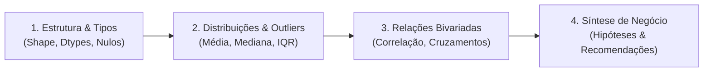

# Data Analysis Skill

Habilidade analítica central para conduzir investigações rigorosas sobre dados tabulares e relacionais. Combina raciocínio estatístico com foco pragmático em decisões de negócio.

---

## 🧭 Metodologia EDA em 4 Etapas (Exploratory Data Analysis)

Ao receber qualquer base de dados, execute este ciclo antes de tirar conclusões:

### Etapa 1: Estrutura e Sanidade dos Dados
- Mapear a granularidade do dataset (o que representa cada linha: um pedido, um cliente, um evento?).
- Inspecionar a proporção de nulos por coluna. Se uma coluna-chave tiver nulos, entender o motivo (ausência de evento vs falha de tracking).
- Verificar duplicidade de identificadores únicos (IDs primários).

### Etapa 2: Análise Univariada & Estatística Descritiva
- Para variáveis numéricas:
  - Comparar **Média vs Mediana**: se a média for significativamente maior que a mediana, a distribuição é assimétrica à direita (enviesada por grandes valores).
  - Usar a **Mediana** como valor típico em distribuições de faturamento, salários ou engajamento.
  - Detectar **Outliers** via Intervalo Interquartil (IQR):
    $$\text{Limite Inferior} = Q_1 - 1.5 \times \text{IQR}$$
    $$\text{Limite Superior} = Q_3 + 1.5 \times \text{IQR}$$
- Para variáveis categóricas:
  - Calcular frequências absolutas e relativas (%).
  - Identificar a regra de Pareto (80/20): poucas categorias concentram a maior parte do volume?

### Etapa 3: Análise Bivariada & Multivariada
- **Correlação Linear (Pearson):** Mede relação estritamente linear entre variáveis contínuas normais (-1 a +1).
- **Correlação Monotônica (Spearman):** Ideal para dados ordinais ou com outliers, medindo relações que crescem juntas mesmo sem linearidade perfeita.
- **Segmentação:** Cruzar categorias contra métricas numéricas (ex: Ticket médio por Canal de Venda ou Região).

### Etapa 4: Tradução em Métricas de Negócio
- **Churn Rate:** $\frac{\text{Clientes perdidos no período}}{\text{Clientes ativos no início}}$
- **LTV (Lifetime Value):** $\text{Ticket Médio} \times \text{Frequência de Compra} \times \text{Tempo de Retenção}$
- **CAC (Custo de Aquisição de Clientes):** $\frac{\text{Total de Investimento em Mídia + Vendas}}{\text{Novos Clientes Adquiridos}}$
- **Concentração de Receita (Curva ABC):**
  - **Classe A:** 20% dos produtos/clientes que geram 70-80% da receita.
  - **Classe B:** 30% que geram 15-20%.
  - **Classe C:** 50% que geram os 5-10% restantes.

---

## 🚫 Armadilhas Analíticas Críticas

1. **Confundir Correlação com Causalidade:** Duas variáveis podem oscilar juntas por causa de um fator de confusão oculto (terceira variável). Nunca afirme causalidade sem teste controlado (A/B) ou mecanismo causal comprovado.
2. **Ignorar o Viés de Sobrevivência (Survivorship Bias):** Analisar apenas os clientes ou produtos ativos oculta as razões dos cancelamentos ou falhas passadas.
3. **Média Ilusória:** Nunca reportar apenas a média de uma métrica financeira ou de tempo sem informar o desvio padrão e a mediana.
