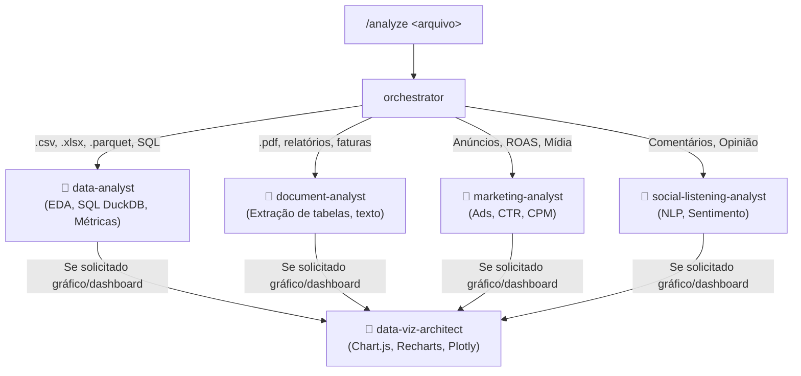

# 📊 Analisar e Visualizar (Analyze Workflow)

O comando `/analyze` inicia um pipeline inteligente de inteligência de dados. O **Orquestrador** avalia o formato da fonte de entrada e aciona o especialista exato para extrair os dados e gerar diagnósticos acionáveis ou dashboards visuais.

---

## 🎯 Como Usar

Digite `/analyze` seguido do caminho do arquivo, pergunta ou objetivo da análise:

**Exemplos:**
- `/analyze dados/vendas_2025.csv. Faça um diagnóstico da base, calcule o ticket médio por região e identifique os 5 clientes mais valiosos.`
- `/analyze documentos/relatorio_trimestral.pdf. Extraia a tabela de DRE da página 4 para CSV e resuma os principais destaques financeiros.`
- `/analyze campanhas/facebook_ads.xlsx. Identifique os criativos campeões e gere um dashboard MD3.`
- `/analyze feedback_clientes.csv. Extraia os temas mais recorrentes e a polaridade dos comentários.`

---

## 🔄 Roteamento Inteligente por Tipo de Dado

1. **Dados Tabulares e Numéricos (.csv, .xlsx, .parquet):**
   - Invocação do `data-analyst` para rodar `profile_dataset.py`, formular consultas via DuckDB e calcular métricas de negócio.
2. **Documentos e PDFs (.pdf):**
   - Invocação do `document-analyst` para rodar `extract_pdf_tables.py`, reconstituir tabelas e manter citações com número de página.
3. **Mídia Paga & Performance (.xlsx de anúncios):**
   - Invocação do `marketing-analyst` para calcular CPA, ROAS e criativos campeões.
4. **Comentários e Social Listening:**
   - Invocação do `social-listening-analyst` para categorização temática e análise de polaridade.
5. **Geração Visual (Dashboards & Gráficos):**
   - O `data-viz-architect` recebe as tabelas consolidadas e implementa a visualização seguindo os princípios de Data Storytelling (sem chartjunk).
