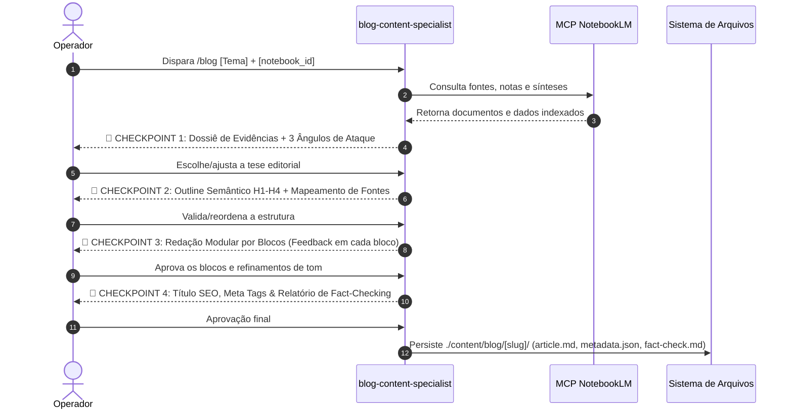

# ✍️ Blog Content & Thought Leadership Engine (/blog)

O comando `/blog` é a porta de entrada para a criação de artigos de blog de alta autoridade, ensaios analíticos e conteúdos de liderança de pensamento (*Thought Leadership*) no **Ananke OS**.

Ele opera sob dois compromissos inegociáveis:
1. **Verdade Ancorada (Grounding):** O artigo exige consulta prévia e mapeamento de fontes em um caderno do **Google NotebookLM** via conector MCP.
2. **Co-Construção Socrática (Zero One-Shot):** O agente constrói a peça em parceria ativa com o operador, passando por **4 Checkpoints Bloqueantes de Aprovação**.

---

## 🛑 As 5 Etapas & 4 Checkpoints do Pipeline

---

## 💡 Exemplos de Uso

* `/blog Escreva um artigo sobre agentes autônomos e SDD usando o caderno notebook_id=xyz123.`
* `/blog Crie um ensaio de Thought Leadership sobre descarbonização da cadeia de suprimentos usando o NotebookLM "Relatórios ESG 2024".`
* `/blog Estruture um guia comparativo de bancos vetoriais ancorado nas notas do meu NotebookLM.`

---

## ⚙️ O que acontece por baixo dos panos?

1. **Assunção de Papel:** O `blog-content-specialist` assume o controle imediato da operação.
2. **Ativação de Skills:**
   * `notebooklm-knowledge-retrieval`: Estabelece conexão com o MCP NotebookLM (`notebook_query`, `source_describe`), valida a densidade das fontes e monta o Dossiê Factual.
   * `seo-blog-architecture`: Define a intenção de busca, a árvore semântica de cabeçalhos e a estratégia de snippets.
   * `thought-leadership-writing`: Garante redação afiada sem clichês de IA (AI-fluff), ancorando dados estatísticos e conduzindo a entrega bloco a bloco.
3. **Checkpoints Interativos:** O fluxo interrompe em cada estágio para receber direcionamentos e aprovações do operador.
4. **Entrega Consolidada:** Salva os arquivos finais em `./content/blog/[slug]/`:
   * `article.md` (Artigo completo formatado em Markdown com citações)
   * `metadata.json` (Título SEO, meta description, slug, palavras-chave LSI)
   * `fact-check.md` (Matriz de auditoria de fontes com referências do NotebookLM)
