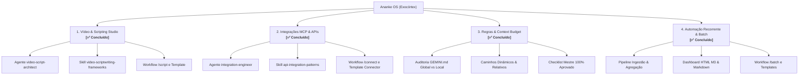

# Especificação Funcional: Diretrizes Mestres do Ananke OS

> **Módulo:** Core System & Exocortex Foundation (Ananke OS)  
> **Tagline:** Spec-Driven Autonomy // Zero Vibe Coding  
> **Metodologia:** Spec-Driven Development (SDD) com Sintaxe EARS  
> **Status:** Aprovado / Baseline Operacional (Fase 1 - SPECIFY)  
> **Classificação:** Diretriz Arquitetural Fundamental (P0)

---

## 1. Visão Geral e Propósito Maior

O **Ananke OS** é um **Sistema Operacional Cognitivo de Raciocínio, Pesquisa, Desenvolvimento, Criação e Prototipagem**. 

Projetado para operar como um **exocórtex soberano** — uma extensão direta da mente humana do seu operador —, o sistema combina alta densidade de ferramentas, automações e uma inteligência distribuída em agentes especialistas capazes de executar desde a concepção abstrata de ideias até a entrega de software robusto, estratégias comerciais, modelos analíticos e narrativas de alta retenção.

### Filosofia Fundamental: *Zero Vibe Coding*
O kit elimina completamente o desenvolvimento por suposições, tentativas cegas ou intuição não fundamentada ("vibe coding"). Toda ação de impacto no ecossistema é precedida de especificação estruturada, garantindo previsibilidade, rastreabilidade e integridade arquitetural.

---

## 2. Pilares de Arquitetura e Agentes Centrais

O kit adota um modelo de **Hub & Specialists**, onde dois agentes atuam como guardiões e motores de partida inegociáveis:

### 2.1 O Guardião Metodológico: `sdd-specialist`
* **Função Primária:** Transformar intenções, ideias e briefings brutos em especificações formais de requisitos na sintaxe EARS antes de qualquer linha de código ou configuração técnica.
* **Critério de Ouro:** Nenhuma implementação complexa tem início sem a documentação em `.specify/` devidamente aprovada pelo operador.

### 2.2 O Regente Operacional: `orchestrator`
* **Função Primária:** Diagnosticar a demanda, rotear para os especialistas certos, coordenar execuções paralelas, sintetizar entregas multidomínio e garantir a conformidade com as regras globais (`GEMINI.md`).
* **Critério de Ouro:** Garantir a coerência transversal entre planejamento, execução, teste e documentação.

---

## 3. Requisitos do Sistema (Sintaxe EARS)

### 3.1 Requisitos Onipresentes (Ubiquitous)
* **UBIQ-01:** O sistema DEVE funcionar como um ecossistema unificado e auto-suficiente, mantendo sincronia entre agentes, skills, workflows e regras de ambiente.
* **UBIQ-02:** O sistema DEVE preservar a língua nativa do usuário para diálogos, explicações e comandos, mantendo código, nomes de variáveis, schemas e documentação técnica internacionalizados em inglês quando padrão da indústria.
* **UBIQ-03:** O sistema DEVE aplicar o protocolo Spec-Driven Development (SDD) em quatro fases distintas: **1. SPECIFY** $\rightarrow$ **2. PLAN** $\rightarrow$ **3. TASKS** $\rightarrow$ **4. IMPLEMENT**.
* **UBIQ-04:** O sistema DEVE monitorar e racionalizar a carga de contexto e o consumo de tokens, carregando apenas skills e arquivos estritamente necessários para a etapa em execução.

### 3.2 Requisitos Disparados por Eventos (Event-Driven)
* **EVT-01:** QUANDO o operador iniciar uma nova demanda, projeto ou funcionalidade, o sistema DEVE acionar o `sdd-specialist` (ou `/sdd`) para conduzir a fase de descoberta e elicitação socrática de requisitos.
* **EVT-02:** QUANDO uma demanda envolver múltiplos domínios (ex: design + backend + métricas), o sistema DEVE invocar o `orchestrator` para articular a sequência lógica de execução dos agentes especialistas.
* **EVT-03:** QUANDO o operador solicitar ajuda com comandos disponíveis, o sistema DEVE fornecer orientação contextual e acionável a partir da matriz de workflows cadastrada no kit.
* **EVT-04:** QUANDO tarefas periódicas (quinzenais ou mensais, ex: atualização de dashboards, higienização de planilhas ou relatórios de ads) forem acionadas, o sistema DEVE executar scripts Python automatizados em lote para minimizar o esforço manual.
* **EVT-05:** QUANDO um novo módulo de conteúdo for solicitado (ex: roteiros e scripts para vídeos), o sistema DEVE orquestrar frameworks de retenção, storytelling e personas estruturadas.

### 3.3 Requisitos Baseados em Estado (State-Driven)
* **STA-01:** ENQUANTO o sistema estiver na fase de especificação (Fase 1 - SPECIFY), nenhum agente PODE escrever código de produção, scaffold de pastas de aplicação ou modificar componentes existentes.
* **STA-02:** ENQUANTO o operador estiver trabalhando na matriz do kit (`ananke-os`), as melhorias em agentes, skills e scripts DEVEM ser testadas contra o script de validação mestre (`python .agent/scripts/checklist.py .`).
* **STA-03:** ENQUANTO um novo projeto for instanciado para um cliente ou produto específico, o sistema DEVE ler as diretrizes visuais em `.specify/brand-guidelines.md` e a especificação local do projeto para manter consistência total.

### 3.4 Requisitos Opcionais / Habilitadores Futuros (Optional)
* **OPT-01:** ONDE servidores MCP (Model Context Protocol) estiverem ativos (ex: Google Analytics, Meta Ads, bancos locais), os agentes especialistas DEVEM conectar diretamente às ferramentas externas para obter métricas em tempo real sem uploads manuais de planilhas.
* **OPT-02:** ONDE APIs externas de IA de geração de mídia ou dados estiverem configuradas, o sistema DEVE fornecer pipelines para automação de assets de ponta a ponta.

### 3.5 Requisitos de Tratamento de Exceções e Indesejados (Unwanted)
* **UNW-01:** SE o operador ou a IA tentar iniciar código direto sem arquivo de especificação em `.specify/` para demandas médias/complexas, ENTÃO o sistema DEVE abortar a execução de código e ativar o portão socrático do SDD.
* **UNW-02:** SE houver conflito ou inconsistência entre regras de contexto (`GEMINI.md` na raiz vs `.agent/rules/`), ENTÃO a hierarquia formal DEVE prevalecer: P0 (`GEMINI.md` raiz/global) > P1 (`.agent/agents/*.md`) > P2 (`SKILL.md`).
* **UNW-03:** SE um prompt ou contexto atingir volume excessivo de tokens devido à leitura desnecessária de diretórios completos, ENTÃO os agentes DEVEM priorizar ferramentas de busca cirúrgica (`grep_search`, fatiamento de linhas em `view_file`) e carregamento seletivo de skills.

---

## 4. Matriz Rápida de Comandos Operacionais (Workflows)

Para mitigar a lacuna de visibilidade de comandos, esta tabela estabelece as portas de entrada oficiais do sistema:

| Comando | Agente Principal | Objetivo Principal | Quando Utilizar |
| :--- | :--- | :--- | :--- |
| `/sdd <tema>` | `sdd-specialist` | Criar especificação formal EARS em `.specify/` | Início de qualquer software, funcionalidade ou sistema |
| `/create <tema>` | `app-builder` + `sdd-specialist` | Scaffolding de novas aplicações completas | Criação de repositórios/apps do zero |
| `/orchestrate <tarefa>` | `orchestrator` | Coordenar múltiplos especialistas em paralelo | Demandas complexas que envolvem várias áreas |
| `/plan <tema>` | `project-planner` | Gerar arquitetura técnica e plano de tarefas (`PLAN.md`) | Fase 2 do SDD, pós-aprovação da especificação |
| `/brainstorm <ideia>` | `project-planner` | Exploração socrática de alternativas de design/negócio | Quando o problema ainda está difuso |
| `/analyze <alvo>` | `data-analyst` / `document-analyst` | Análise de planilhas (CSV/XLSX), dados e PDFs | Auditoria de números, finanças, faturas e relatórios |
| `/batch [quinzenal\|mensal]` | `data-analyst` / `orchestrator` | Pipeline em lote de dados e relatórios periódicos | Fechamentos e dashboards automáticos em `data/` |
| `/connect <serviço>`| `integration-engineer` | Conectores de APIs e servidores MCP testados | Integração com serviços externos, SaaS e CRMs |
| `/sql <query/pergunta>` | `data-analyst` | Consultas analíticas ultrarrápidas via DuckDB | Perguntas diretas sobre datasets sem servidor SQL |
| `/strategy <tema>` | `business-strategist` | Modelagem de negócio, bundles e precificação | Definição de preços, pacotes comerciais e monetização |
| `/copy <briefing>` | `copywriter-ux` | Textos persuasivos de venda e UX microcopy | Landing pages, e-mails de vendas e interfaces |
| `/post <briefing>` | `social-media-designer` | Geração de posts visuais e carrosséis com roteiro | Conteúdo para Instagram, LinkedIn e Twitter/X |
| `/script <briefing>`| `video-script-architect` | Roteirização audiovisual em teleprompter e 2 colunas | Roteiros para Reels/TikTok e YouTube |
| `/refactor <alvo>` | `code-archaeologist` | Otimização interna de código e eliminação de debt | Refatoração estrutural sem alteração de regra externa |
| `/debug <erro>` | `debugger` | Diagnóstico de causa-raiz em 4 fases | Erros complexos, travamentos e bugs elusivos |
| `/test <alvo>` | `test-engineer` | Criação e execução de suítes de teste (AAA) | Validação unitária, integração e regressão |
| `/preview` | `orchestrator` | Gerenciar dev server local de visualização | Inspeção de interfaces e protótipos web |
| `/deploy` | `devops-engineer` | Validações pré-voo e publicação em produção | Releases seguras e automações de deploy |
| `/status` | `orchestrator` | Exibir quadro de progresso e estado do projeto | Acompanhamento de entregas e fases do SDD |

---

## 5. Roteiro Estratégico de Evolução

O desenvolvimento do **Ananke OS** atingiu 100% de conformidade com todos os 4 eixos estratégicos de expansão:



### 5.1 Sistema de Criação de Conteúdo e Roteiros de Vídeos `[✅ Concluído]`
* **Agente Especialista:** [`video-script-architect`](../.agent/agents/video-script-architect.md) integrado aos 35 agentes do kit.
* **Skill Dedicada:** [`video-scriptwriting-frameworks`](../.agent/skills/video-scriptwriting-frameworks/SKILL.md) com técnicas de retenção (gancho de 3s, micro-recompensas visuais, loops abertos e CTAs de compromisso gradual).
* **Workflow Operacional:** [`/script`](../.agent/workflows/script.md) homologado.
* **Template Padronizado:** [`assets/scripts/template-roteiro.md`](../assets/scripts/template-roteiro.md) entregando versão Teleprompter (baixa carga cognitiva) e Tabela de 2 Colunas para pós-produção.
* **Especificação SDD:** Documentada em Consolidada na Seção correspondente deste documento.

### 5.2 Engenharia de Integrações de APIs & Servidores MCP `[✅ Concluído]`
* **Agente Especialista:** [`integration-engineer`](../.agent/agents/integration-engineer.md), especialista agnóstico responsável por pesquisar documentações na web, orientar a obtenção segura de credenciais, decidir tecnologias com o operador (TypeScript vs Python) e fornecer código modular.
* **Skill Dedicada:** [`api-integration-patterns`](../.agent/skills/api-integration-patterns/SKILL.md) e atualização de [`nodejs-best-practices`](../.agent/skills/nodejs-best-practices/SKILL.md) com suporte a Node 20.6+ nativo (`process.loadEnvFile()`).
* **Workflow Operacional:** [`/connect`](../.agent/workflows/connect.md) cadastrado e validado.
* **Template Padronizado:** Diretório [`integrations/template-connector/`](../integrations/template-connector/) com `connector.ts`, `test_connection.ts`, `.env.example` e `README.md`.
* **Especificação SDD:** Documentada em Consolidada na Seção correspondente deste documento.

### 5.3 Governança de Regras, Arquitetura e Context Budget `[✅ Concluído]`
* **Eliminação de Conflito de Regras:** Calibração do `GEMINI.md` global em `C:\Users\User\.gemini\GEMINI.md` (diretiva enxuta de 3 linhas) e do `GEMINI.md` local em `.agent/rules/` (eliminação de injeção duplicada de 8k tokens).
* **Caminhos Dinâmicos e Relativos:** Migração de referências rígidas de sistema para caminhos portáveis e relativos (`./.agent/...`, `./integrations/...`, `./.specify/...`).
* **Sincronização Mestra da Arquitetura:** Base oficializada em 35 Agentes, 54 Skills e 21 Workflows em [`ARCHITECTURE.md`](../.agent/ARCHITECTURE.md), [`README.md`](../README.md) e [`categorias.md`](../.agent/docs/categorias.md).
* **Auditoria de Integridade:** Validação de 100% de sucesso mantida em `python .agent/scripts/checklist.py .`.

### 5.4 Automações Periódicas e Batch (Rotinas Quinzenais / Mensais) `[✅ Concluído]`
* **Módulo:** Suíte completa em [`.agent/scripts/automations/`](../.agent/scripts/automations/) com `ingest_batch.py`, `aggregate_metrics.py`, `render_report.py` e `run_batch.py`.
* **Templates Agnósticos:** Schemas analíticos pré-configurados em [`data/templates/marketing_ads.json`](../data/templates/marketing_ads.json) e [`data/templates/sales_ecommerce.json`](../data/templates/sales_ecommerce.json).
* **Entregáveis Gerados:** Dashboard interativo em HTML (Material Design 3 Dark Theme com Chart.js) e Sumário Executivo em Markdown com timestamp em `data/reports/`.
* **Workflow Operacional:** [`/batch`](../.agent/workflows/batch.md) documentado e operacional.
* **Especificação SDD:** Documentada em Consolidada na Seção correspondente deste documento.

---

## 6. Critérios de Sucesso e Aceite

1. **Rastreabilidade:** Qualquer agente ou humano que consultar este arquivo compreenderá imediatamente a finalidade ontológica do kit, seus agentes mestres e sua esteira de valor.
2. **Conformidade do Kit:** O kit matriz deve manter 100% de aprovação no script de auditoria:
   ```bash
   python .agent/scripts/checklist.py .
   ```
3. **Imutabilidade Operacional sem SDD:** O kit deve ser rigoroso na rejeição de solicitações sem especificação clara prévia, mantendo o operador no papel de estrategista/diretor e a IA no papel de engenheira de alta precisão.
4. **Sincronização Visual Obrigatória (Brain Map):** Qualquer novo agente, skill ou workflow incluído no ecossistema DEVE ser obrigatoriamente espelhado em [`brain-map/brain-data.js`](../brain-map/brain-data.js), garantindo que o mapa mental 3D permaneça como fonte visual fidedigna e atualizada para novos membros da equipe e desenvolvedores.
