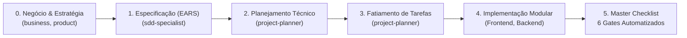

<div align="center">

# ⚡ ANANKE OS

### **Spec-Driven Autonomy // Zero Vibe Coding**
**O Sistema Operacional Cognitivo de Engenharia de Software e Inteligência Autônoma.**

[](https://github.com)
[](https://github.com)
[](https://github.com)
[](.agent/docs/categorias.md)
[](.agent/docs/categorias.md)
[](.agent/scripts/)

<br>

<p align="center">
  <i>"Nem mesmo os deuses lutam contra Ananke."</i><br>
  — <b>Tradição Órfica da Grécia Antiga</b>
</p>

---

</div>

## 🌌 1. Manifesto: A Morte do *"Vibe Coding"*

No desenvolvimento de software com inteligência artificial, o erro mais comum é o **"Vibe Coding"**: jogar um prompt genérico, receber 400 linhas de código aleatório, torcer para funcionar e passar dias depurando alucinações e débitos técnicos.

O **Ananke OS** foi construído sob o princípio oposto: **Determinismo e Causalidade**.

Na mitologia grega, **Ananke (Ἀνάγκη)** é a personificação primordial da **Necessidade Inevitável** — a força cósmica que governa as leis imutáveis do universo. No **Ananke OS**, o software não é fruto de tentativa e erro: **ele é uma consequência inevitável de uma especificação formal perfeita**.

Se o requisito for inquestionável, a arquitetura for testada e as tarefas forem fatiadas com rigor, **o código resultante funciona de primeira**.

---

## 🏛️ 2. A Esteira de Governança SDD (Spec-Driven Development)

O Ananke OS opera sob uma esteira inviolável de **4 fases sequenciais**, garantindo que nenhuma linha de código seja gerada sem aprovação prévia de especificação:



1. **Fase 1: SPECIFY (`@sdd-specialist` | `/sdd`)**
   - Transforma intenções brutas em requisitos formais na **Sintaxe EARS** (*Easy Approach to Requirements Syntax*).
   - Documenta regras de negócio inequívocas em `.specify/*.md`.
2. **Fase 2: PLAN (`@project-planner` | `/plan`)**
   - Transforma a especificação aprovada em modelo de dados, contratos de API e arquitetura em `PLAN.md`.
3. **Fase 3: TASKS (`@project-planner` | `/tasks`)**
   - Fatiamento da entrega em tarefas atômicas, isoladas e orientadas a testes (TDD/AAA).
4. **Fase 4: IMPLEMENT (Especialistas Técnicos)**
   - Codificação modular rigorosa. O código só é considerado pronto após passar pelos 6 gates do Master Checklist.

---

## 🧠 3. Visualizador 3D Brain Map (WebGL Neural Network)

O Ananke OS possui um **gêmeo digital topológico tridimensional** localizado em [`brain-map/`](brain-map/). Uma constelação neural em WebGL Three.js renderiza todo o ecossistema com física de forças orgânica:

<div align="center">

| Cor | Elemento | Quantidade | Descrição |
| :---: | :--- | :--- :--- | :--- |
| 🟡 | **Agentes Especialistas** | **38 nós** | Personas ativas de IA com raciocínio hiperfocado. |
| 🔴 | **Workflows de Comando** | **24 nós** | Procedimentos acionados por `/comando` no chat. |
| 🔵 | **Skills & Conexões** | **62 nós** | Módulos técnicos com partículas luminosas em tempo real. |
| 🟠 | **Macro-Categorias** | **8 núcleos** | Grandes centros gravitacionais de competência do OS. |
| 🟢 | **Ciclo de Governança** | **4 fases** | A espinha dorsal metodológica do SDD. |

</div>

* **Navegação Espacial 360°:** Rotação orbital contínua, pan de câmera e zoom suave via scroll ou botões táteis (`+` / `−` / `↺`).
* **Inspeção Neural:** Clique em qualquer esfera para centralizar a câmera, iluminar conexões e abrir painel lateral com detalhes.
* **Busca em Tempo Real:** Digite palavras-chave (ex: `vídeo`, `flow`, `mcp`, `sdd`, `email`) para filtrar instantaneamente a constelação.

👉 **Para visualizar:** Abra [`brain-map/index.html`](brain-map/index.html) em qualquer navegador moderno.

---

## 👥 4. O Panteão: 38 Agentes Especialistas em 8 Hubs

Os agentes do Ananke OS são personas profissionais com instruções de sistema estritas, proibição de premissas vagas e domínio das melhores práticas de mercado:

```plaintext
anankeos/
├── 🏛️ Governança & Orquestração      --> @orchestrator, @sdd-specialist, @project-planner
├── 🎨 Engenharia Frontend & UI/UX     --> @frontend-specialist, @css-architect, @mobile-developer
├── ⚙️ Backend, Integrações & MCP      --> @backend-specialist, @integration-engineer, @api-designer, @database-architect
├── 📊 Dados, BI & Análise             --> @data-analyst, @document-analyst, @data-viz-architect
├── 🚀 Marketing, Conteúdo & Mídia     --> @copywriter-ux, @social-media-designer, @video-script-architect, @motion-video-engineer, @email-marketing-specialist, @blog-content-specialist, @marketing-analyst
├── 🛡️ Segurança & Infraestrutura      --> @security-auditor, @penetration-tester, @devops-engineer, @performance-optimizer
├── 🧪 Qualidade, Testes & Diagnóstico  --> @test-engineer, @qa-automation-engineer, @debugger, @code-archaeologist
└── 💼 Estratégia de Negócio & Produto --> @business-strategist, @product-manager, @product-owner
```

---

## ⚡ 5. Workflows de Comando (`/slash-commands`)

Comandos rápidos para acionar os pipelines mestres do Ananke OS:

| Comando | Especialista Líder | O que o Workflow Executa |
| :--- | :--- | :--- |
| `/sdd <nome>` | `@sdd-specialist` | Inicia novo projeto com especificação formal EARS |
| `/orchestrate <briefing>` | `@orchestrator` | Diagnostica, fatia e coordena múltiplos especialistas em paralelo |
| `/connect <serviço>` | `@integration-engineer` | Conecta APIs externas e servidores MCP com resiliência e testes |
| `/script <briefing>` | `@video-script-architect` | Roteiriza vídeos para teleprompter e tabela de edição em 2 colunas |
| `/reel <arquivo>` | `@motion-video-engineer` | Edição programática de vídeo em 5 camadas (HyperFrames), motion GSAP e ponte Google Flow |
| `/post <briefing>` | `@social-media-designer` | Gera carrosséis e posts com identidade visual guiada |
| `/blog <notebook>` | `@blog-content-specialist` | Artigos de blog e Thought Leadership ancorados no Google NotebookLM |
| `/email <briefing>` | `@email-marketing-specialist` | Campanhas de e-mail, cold outreach B2B, newsletters tabulares e leads |
| `/copy <briefing>` | `@copywriter-ux` | Textos persuasivos de venda, microcopy e páginas de alta conversão |
| `/strategy <tema>` | `@business-strategist` | Modelagem comercial, esteira de produtos e precificação |
| `/batch <frequência>` | `@data-analyst` | Processa dados em lote e gera Dashboard HTML (M3 Dark) em `data/reports/` |
| `/debug <erro>` | `@debugger` | Investigação metódica em 4 fases para identificação de causa-raiz |
| `/test` | `@test-engineer` | Criação e execução de suítes de teste automatizadas (AAA/TDD) |
| `/preview` | `@orchestrator` | Inicializa servidor de desenvolvimento local para inspeção |
| `/deploy` | `@devops-engineer` | Validações pré-voo e publicação segura em produção |

---

## 🌟 Novidades da Plataforma (Release Recente)

- 🎬 **HyperFrames Parametric Motion Engine & Google Flow Bridge (`/reel`):**
  - Motor de edição programática vertical (1080×1920) em 5 camadas: Take bruto, legendas temporais cinéticas, máscara/card dinâmico de rosto, motion graphics paramétricos a cada 2-3s e sound design.
  - Curvas de aceleração física via GSAP (`back.out(1.7)` com overshoot orgânico), safe zones para Instagram Reels/TikTok e design tokens de marca adaptáveis (`video-tokens.css`).
  - Automação headless via Playwright para o estúdio de IA criativa **Google Flow** (`flow.google.com`), permitindo listar projetos, descarregar assets e gerar clipes de B-roll usando os créditos Pro da sua conta Google sem configurações manuais repetitivas.
- 💡 **NotebookLM Thought Leadership Suite (`/blog`):**
  - Engenharia de artigos analíticos e liderança intelectual ancorados estritamente em cadernos do **Google NotebookLM** via conector MCP dedicado.
  - Processo de co-construção socrática em blocos iterativos (Tese, Antítese, Síntese e Aplicação), com eliminação cirúrgica de clichês de IA (*AI Fluff*) e citações verificáveis.
- ✉️ **E-mail Marketing & Outbound Leads Suite (`/email`):**
  - Criação completa de sequências de prospecção ativa B2B (Cold Outreach), auditoria de entregabilidade DNS (SPF, DKIM, DMARC) e cálculo preditivo de pontuação anti-spam.
  - Engenharia de templates de e-mail em HTML tabular responsivo testado contra 60+ clientes (Outlook desktop, Gmail, Apple Mail) com espelho em Plain Text.
  - Raspagem ética da web e enriquecimento tabular de contatos com validação de sintaxe.

---

## 🛡️ 6. Qualidade Inviolável: Master Checklist (6 Gates Automatizados)

Nenhum código é considerado pronto no Ananke OS sem passar pelo script unificado de auditoria:

```bash
python .agent/scripts/checklist.py .
```

A esteira de verificação executa 6 verificações rigorosas:

1. 🔒 **Security Scan:** Varredura estrita contra injeções SQL, XSS, vulnerabilidades e exposição de chaves privadas.
2. 🧹 **Lint Check:** Conformidade sintática e boas práticas idiomáticas de código.
3. 🗄️ **Schema Validation:** Integridade referencial, normalização e consistência relacional.
4. 🧪 **Test Runner:** Execução obrigatória de testes automatizados com asserções limpas (Padrão AAA).
5. 👁️ **UX Audit:** Auditoria automática de mais de 80 regras de psicologia cognitiva (Leis de Hick, Fitts, Miller), contraste WCAG, alvos de toque e acessibilidade.
6. 📈 **SEO Check:** Validação de tags semânticas HTML5, Open Graph, meta descriptions e títulos.

---

## 🚀 7. Como Usar o Ananke OS

### Opção A: Usar como Template no GitHub (Recomendado)
1. Clique no botão **"Use this template"** no topo deste repositório.
2. Dê o nome do seu novo projeto (ex: `saas-financeiro` ou `portal-cliente`).
3. Clone na sua máquina e abra na IDE. O Ananke OS estará operacional imediatamente na raiz.

### Opção B: Clonar Manualmente
```bash
# Clone o repositório
git clone https://github.com/SEU-USUARIO/anankeos.git meu-projeto

# Acesse o diretório
cd meu-projeto

# Inicie seu primeiro fluxo orientado a especificação
# No chat da IDE, digite: /sdd NomeDaMinhaAplicacao
```

---

## 📁 8. Estrutura do Repositório

```plaintext
anankeos/
├── .agent/                  # O Cérebro do OS: 38 Agentes, 62 Skills, 24 Workflows e Scripts
│   └── docs/                # Taxonomia Completa (categorias.md) e Catálogo de Skills
├── .github/                 # Workflows Automatizados de CI/CD (GitHub Actions)
├── .specify/                # Especificações Formais (EARS), Diretivas e Brand Guidelines
├── assets/                  # Identidade Visual, Logotipos e Mockups do Ecossistema
├── brain-map/               # Mapeamento Tridimensional Neural Interativo (WebGL)
├── data/                    # Pipeline de Ingestão e Relatórios Batch Automatizados
├── integrations/            # Conectores de APIs, Analytics, Meta Ads e Servidores MCP
├── .gitignore               # Blindagem Estrita de Credenciais e Ambientes
├── LICENSE                  # Licença MIT de Código Aberto
├── requirements-optional.txt# Dependências Opcionais para Scripts de Skills
└── README.md                # O Cartão de Visitas do Sistema
```

---

## 🔧 9. Desenvolvimento Continuado & Contribuição

O **Ananke OS** é um ecossistema vivo, desenhado para expansão contínua por engenheiros, pesquisadores de IA e equipes de produto que buscam transcender os débitos técnicos do *vibe coding* e estabelecer um novo patamar de engenharia de precisão.

Se você deseja:
- **Evoluir o ecossistema:** Criar novos agentes especialistas, novas skills de domínio ou novos workflows de comando;
- **Aplicar em projetos reais:** Usar o Ananke OS como base operacional para construir sistemas de ponta a ponta sem alucinações;
- **Contribuir com a comunidade:** Aprimorar os scripts de auditoria, modelos de integração ou a física do Brain Map 3D;

👉 **Seu ponto de partida obrigatório é o guia mestre:**
### 📖 [`.agent/how_to.md`](.agent/how_to.md) — Guia Prático de Operação e Governança SDD

Nele você aprenderá:
1. **Como escrever o Briefing Perfeito de 4 Pilares** (Problema Core, Atores, Happy Path e Restrições);
2. **Como conduzir a esteira inviolável de 4 Fases** (`SPECIFY` → `PLAN` → `TASKS` → `IMPLEMENT`);
3. **A Dica de Ouro:** Como manter os agentes disciplinados e interromper suposições antes de qualquer linha de código.

> *"O futuro do desenvolvimento assistido por IA não pertence a quem gera mais código, mas a quem especifica com maior clareza."*  
> Junte-se a nós, bifurque o repositório, abra issues e pull requests, e ajude a construir o padrão definitivo de autonomia com determinismo!

---

<div align="center">

**Construído para engenheiros, estrategistas e criadores que exigem precisão absoluta.**<br>
*Ananke OS • Deterministic Intelligence & Spec-Driven Autonomy.*

</div>
